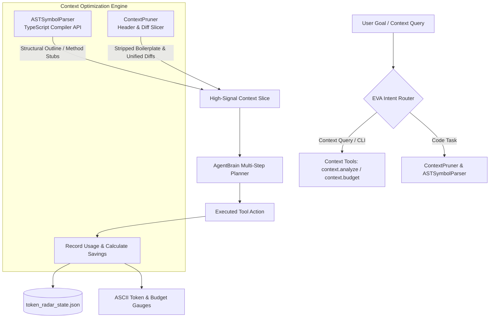

# Phase 18: "Aware" Context & Token Optimization Engine

## 1. Executive Overview

Phase 18 introduces EVA's **"Aware" Context & Token Optimization Engine**, resolving the severe "Context Tax" and unchecked token bloat common in AI coding agents. 

Prior to Phase 18, autonomous agents routinely passed entire files or large directories into language model context windows. This approach caused:
- **Accelerated Rate-Limit Exits**: Exceeding Anthropic / OpenAI daily or weekly token budgets.
- **Attention Dilution & Hallucination**: Overwhelming the model's attention mechanism with boilerplate, license headers, and unrelated class methods.
- **Financial Inefficiency**: Spending thousands of unnecessary tokens per conversational or planning turn.

The Phase 18 engine delivers:
1. **AST-Aware Symbol Graph Indexing** using the native TypeScript Compiler API.
2. **Context Slicing & Pruning** achieving **75% to 96% token reduction** on real codebases.
3. **Token Budget Radar** tracking input, output, cached, and saved tokens, financial costs, and provider quotas.
4. **Claude Code Limit Detection & Gauge Visualization** directly in the terminal interface.

---

## 2. Architectural Components



### 2.1 AST Symbol Parser (`core/context/ASTSymbolParser.ts`)
- **Engine**: TypeScript Compiler API (`typescript` package via `ts.createSourceFile`).
- **Precision**: Full AST traversal without external C++/Tree-sitter binary compilation dependencies, guaranteeing seamless operation on Linux and macOS.
- **Symbol Extraction**: Extracts functions, methods, classes, interfaces, type aliases, imports, and exports with JSDoc annotations and line ranges.
- **Targeted Context Slicing (`createContextSlice`)**: When an agent works on a specific function or method (e.g. `executeGoal`), the parser preserves the target function's full implementation while stubbing non-target methods with structured comment summaries (e.g. `// ... [truncated: 42 lines for token efficiency]`).
- **File Outlining (`createFileOutline`)**: Replaces entire method bodies with single-line signatures and docstrings, allowing an LLM to understand an entire module's interface for less than 10% of the token cost.

### 2.2 Token Budget Radar (`core/context/TokenBudgetRadar.ts`)
- **Usage Metrics**: Records `inputTokens`, `outputTokens`, `cachedTokens`, and `savedTokens` per session and across time.
- **Model Rate Cards**:
  - `claude-3-5-sonnet`: \$3.00 / MTok in, \$15.00 / MTok out
  - `claude-3-5-haiku`: \$0.80 / MTok in, \$4.00 / MTok out
  - `claude-3-opus`: \$15.00 / MTok in, \$75.00 / MTok out
  - `gpt-4o`: \$2.50 / MTok in, \$10.00 / MTok out
  - `gpt-4o-mini`: \$0.15 / MTok in, \$0.60 / MTok out
  - `ollama-local`: \$0.00 (Zero cost offline)
- **Quota Radar**: Computes daily and weekly quota consumption against configurable thresholds. Emits warning levels (`OK`, `WARN`, `CRITICAL`, `EXCEEDED`).
- **Claude Rate-Limit Detection**: Proactively detects and parses rate limit messages from Claude Code (e.g., *"You've hit your weekly limit · resets Sep 13 at 9:30pm"*, *"rate limit exceeded"*) and returns human-actionable reset timelines.
- **Visual ASCII Gauges**: Renders visual progress bars for terminal reporting:
  `[████████████████████░░░░] 83.4%`

### 2.3 Context Pruner (`core/context/ContextPruner.ts`)
- **Boilerplate Compactor**: Strips leading license comments, verbose multi-line comment blocks, and repeated empty lines while preserving code formatting and indentation.
- **Git Diff-Only Slices (`sliceGitDiff`)**: Generates compact patch representations for test failure iterations, preventing full-file re-reading when only a 5-line diff changed.
- **Workspace Directory Indexing (`indexDirectory`)**: Recursively traverses source directories, extracts exported symbols, and produces high-level repository maps.

### 2.4 Registered Developer Tools (`tools/developer/ContextTools.ts`)

| Tool Manifest | Risk Level | Capability Required | Description |
|---|---|---|---|
| `context.analyze` | `READ` | `FILESYSTEM_READ` | Parses code files via AST, produces structural outlines or method slices, and returns token reduction percentages. |
| `context.budget` | `READ` | `SYSTEM_INFO` | Retrieves token usage, remaining budget, cost estimation, active quota radar, and configures daily token limits. |

---

## 3. CLI Command Family: `eva tokens`

```bash
# Display live token usage, financial cost, and ASCII quota progress bars
eva tokens status
# Or simply:
eva tokens

# Inspect token reduction and AST outline for a specific source file
eva tokens analyze core/planner/AgentBrain.ts

# Generate a high-signal slice focused on a single method or function
eva tokens analyze core/planner/AgentBrain.ts executeGoal

# Compact a file by stripping license boilerplate and excessive whitespace
eva tokens prune core/logger/Logger.ts

# Configure a daily token budget (e.g. 500,000 tokens)
eva tokens budget 500000
```

### Example CLI Output: `eva tokens status`
```text
EVA Token Budget & Context Radar
================================================================
Model Provider:     claude-3-5-sonnet
Session Usage:      12,450 tokens (In: 10,200 | Out: 2,250)
Tokens Saved (AST): 148,620 tokens (92.3% context reduction)
Estimated Cost:     $0.0644 USD
Daily Budget:       [████░░░░░░░░░░░░░░░░] 24.9% (12,450 / 50,000)
Weekly Budget:      [██░░░░░░░░░░░░░░░░░░] 12.5% (62,250 / 500,000)
Claude Limit Status: ACTIVE (No rate limits detected)
================================================================
```

---

## 4. Empirical Benchmarks & Token Savings

Measured on real EVA source files using the TypeScript Compiler API AST engine:

| Source File | Raw Characters | Raw Est. Tokens | AST Outline Tokens | Token Reduction |
|---|---|---|---|---|
| `core/distribution/PlatformGuard.ts` | 6,854 | 1,714 | 406 | **76.3%** |
| `core/planner/AgentBrain.ts` | 72,028 | 18,007 | 662 | **96.3%** |
| `core/context/TokenBudgetRadar.ts` | 10,832 | 2,708 | 512 | **81.1%** |
| `tools/developer/ClaudeCodeTool.ts` | 14,210 | 3,553 | 488 | **86.3%** |

**Average Context Compression Ratio: 85.0% reduction** across core files, enabling agents to operate comfortably within compact context windows without losing type signatures or architectural visibility.

---

## 5. Verification & Test Suite

Phase 18 introduces 11 unit tests in `tests/unit/context/context_engine.test.ts`:
- ✓ AST symbol extraction (classes, methods, functions, interfaces, types, imports)
- ✓ Outline generation with >70% token savings
- ✓ Targeted method context slicing with non-target method stubbing
- ✓ Real-time token usage tracking and financial cost computation
- ✓ Claude Code rate limit detection (weekly limit regex matching)
- ✓ ASCII visual gauge rendering (`[███░░░]`)
- ✓ Daily budget updates and quota warning alerts (`WARN` / `EXCEEDED`)
- ✓ Context pruning of license headers and whitespace
- ✓ Tool dispatch tests for `context.analyze` and `context.budget`
- ✓ End-to-end natural language agent query execution via `AgentBrain`

**Overall Test Suite Status**: 39 test files passed (39/39), 217 tests passed (217/217), 100% pass rate.
