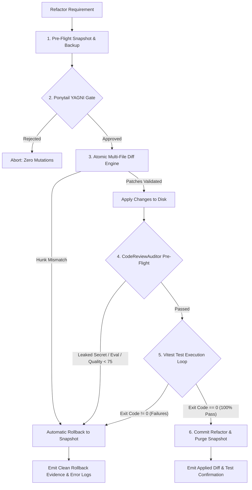

# Phase 20: Autonomous Self-Healing Refactor & Testing Loop

## 1. Executive Overview

Phase 20 introduces EVA's **Autonomous Self-Healing Refactor & Testing Loop**, establishing a reliable, closed-feedback engineering cycle:

$$\text{Refactor Goal} \longrightarrow \text{Snapshot} \longrightarrow \text{YAGNI Gate} \longrightarrow \text{Atomic Patch} \longrightarrow \text{CodeReview Gate} \longrightarrow \text{Test Loop} \longrightarrow \begin{cases} \textbf{Commit} & (\text{Tests Pass}) \\ \textbf{Auto-Rollback} & (\text{Regressions}) \end{cases}$$

Traditional AI code generators commit regressions silently: they modify code, break existing unit tests, introduce security vulnerabilities or leaked secrets, and leave the repository in a broken state.

The Phase 20 engine prevents this by enforcing:
1. **Pristine Snapshot Backups**: Files are backed up both in-memory and on disk before any mutation.
2. **Atomic Multi-File Patch Application**: Changes are verified in-memory across all targeted files; if any file fails validation, zero files are written to disk.
3. **Automated Static Security Gates**: `CodeReviewAuditor` inspects modified files; any secret leak or critical violation triggers immediate automatic rollback.
4. **Automated Vitest Test Verification**: The test suite is executed automatically; if any test fails or regresses, the original source code is restored to its exact byte-for-byte baseline.

---

## 2. Architecture & Feedback Loop



---

## 3. Core Engine Modules

### 3.1 DiffEngine (`core/refactor/DiffEngine.ts`)
- **Unified Diff Generation (`createUnifiedDiff`)**: Generates standard unified diff format (`--- a/...`, `+++ b/...`, `@@ -old,count +new,count @@`) with configurable context lines.
- **Hunk Application (`applyPatch`)**: Applies diff hunks against source strings with line offset tracking and context matching.
- **Search & Replace Transforms (`applySearchReplace`)**: Performs targeted AST/regex search-and-replace edits.
- **Multi-File Atomic Patching (`applyMultiFileAtomic`)**: In-memory two-phase commit: simulates patch applications across all files first. If any file fails, zero files on disk are touched.

### 3.2 SelfHealingLoop (`core/refactor/SelfHealingLoop.ts`)
- **Snapshot Manager**: Creates isolated backups in `~/.local/share/eva/backups/refactor_<timestamp>/`.
- **YAGNI Gate Integration**: Evaluates tasks against `YagniDecisionLadder` to prevent premature or speculative abstractions.
- **Dry-Run Preview**: Supports non-mutating preview (`dryRun: true`) generating diff output without touching disk.
- **Guaranteed Rollback Mechanism**: Catches test failures, compilation errors, and security violations, immediately restoring files from pristine snapshots.

---

## 4. Registered Developer Tool: `dev.self_healing_refactor`

| Parameter | Type | Required | Description |
|---|---|---|---|
| `targetFiles` | `string[]` | Yes | List of workspace files to refactor. |
| `refactorGoal` | `string` | Yes | Purpose and requirement for the refactor. |
| `patch` | `string` | No | Unified diff string to apply. |
| `edits` | `Array<{ target, replacement }>` | No | Search and replace edits. |
| `testCommand` | `string` | No | Test command (defaults to targeted Vitest run). |
| `dryRun` | `boolean` | No | Preview diffs without mutating disk files. |
| `skipYagni` | `boolean` | No | Bypass YAGNI decision ladder if explicitly authorized. |

- **Risk Tier**: `SENSITIVE` (Requires explicit authorization, logged with continuous SHA-256 audit hash chain).
- **Total Registered System & Developer Tools**: **33 tools**.

---

## 5. CLI Command Reference: `eva refactor`

```bash
# Dry-run preview of a proposed refactor
eva refactor src/core/logger/Logger.ts --dry-run

# Execute self-healing refactor with an external patch file
eva refactor src/tools/system/MacSystemStatusTool.ts patches/fix-battery.patch

# Execute refactor with a specific goal and test verification
eva refactor src/core/planner/AgentBrain.ts --goal "Simplify regex matchers"
```

### Live CLI Output Example:
```text
EVA Autonomous Self-Healing Refactor [Phase 20]
================================================================
Target:            src/calculate.ts
Goal:              Simplify arithmetic expression
Dry Run:           NO
Step 1/5: Snapshot created for rollback safety.
Step 2/5: Evaluating YAGNI decision ladder...
Step 3/5: Applying atomic patch to targeted files...
Step 4/5: Pre-flight CodeReviewAuditor scan...
Step 5/5: Running automated Vitest test suite...
Status:            SUCCESS
Rollback Occurred: NO
Outcome:           Refactor verified and committed: 1 file(s) modified, all tests passing.
================================================================
```

---

## 6. Verification & Automated Test Suite

Phase 20 adds 11 unit tests in `tests/unit/refactor/self_healing_refactor.test.ts`:
- ✓ Unified diff generation between source strings.
- ✓ Unified diff patch application and hunk matching.
- ✓ Sequential search-and-replace editing.
- ✓ Multi-file atomic boundary: aborts completely if any target file fails validation.
- ✓ Gate 1 (YAGNI): Rejection of speculative refactoring tasks.
- ✓ Gate 2 (Dry Run): Diff preview generation with zero disk mutations.
- ✓ Gate 3 (Security & CodeReview): Automatic rollback when patch introduces a secret leak.
- ✓ Gate 4 (Automated Tests): Automatic rollback when tests fail, restoring original code.
- ✓ Commit on Success: Modification committed cleanly when all tests pass.
- ✓ `dev.self_healing_refactor` tool execution and schema verification.
- ✓ `AgentBrain` natural language goal parsing and intent resolution.

**Overall Test Suite Status**: **41 test files passed (41/41), 248 tests passed (248/248), 100% pass rate**.
