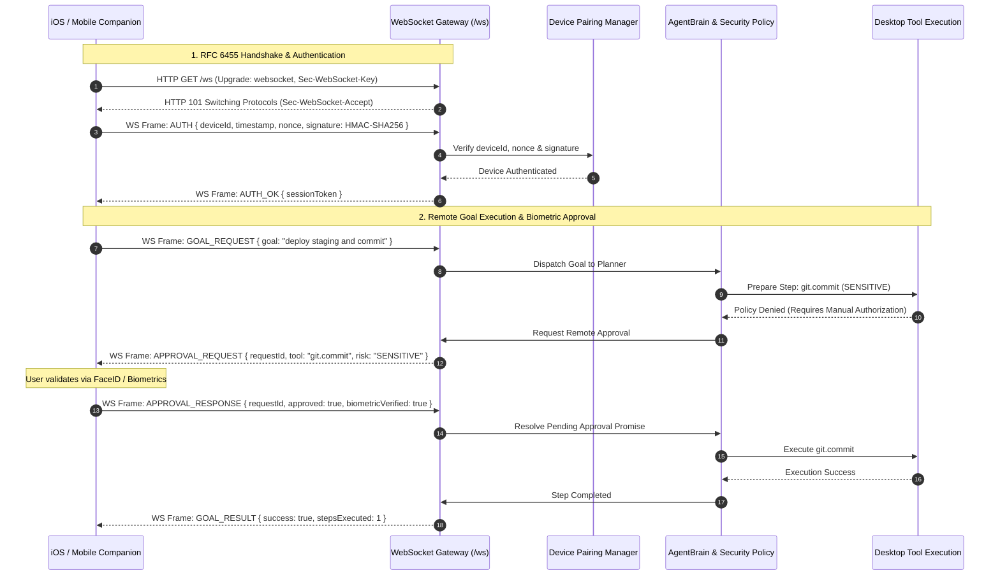

# Phase 21: Production Companion Mobile App & WebSocket Gateway

## 1. Executive Overview

Phase 21 introduces EVA's **Production Mobile Companion Gateway**, bridging mobile devices (iOS SwiftUI / Android) directly to the EVA Desktop Agent Runtime over an encrypted, high-performance WebSocket connection.

In strict adherence to the **Ponytail YAGNI Engineering Framework**, the entire RFC 6455 WebSocket protocol and frame encoder/decoder is implemented using **zero external npm dependencies** (leveraging Node.js standard libraries `node:http`, `node:net`, and `node:crypto`).

Key capabilities delivered:
1. **RFC 6455 Compliant Gateway**: Native HTTP `Upgrade: websocket` handling, SHA-1 Sec-WebSocket-Accept generation, ping/pong heartbeats, and client-unmasking frame parser.
2. **Cryptographic HMAC-SHA256 Device Pairing & Auth**: 6-digit one-time pairing code flow with persistent device secret generation, anti-replay nonce tracking, and timestamp expiration windows (30-second TTL).
3. **Remote Biometric Capability Approvals**: Out-of-band authorization for sensitive tools (e.g. `git.commit`, `terminal.exec`, `fs.write`). Execution suspends on the desktop, prompts the mobile companion with FaceID/TouchID confirmation, and resumes immediately upon signoff.
4. **Remote Push-to-Talk (PTT) Audio Relay**: Bidirectional streaming of PCM/WAV audio frames from mobile microphone directly into EVA's desktop speech pipeline.

---

## 2. Architecture & Communication Flow



---

## 3. Core Modules & Implementation Details

### 3.1 `WebSocketGateway.ts` (`core/companion/WebSocketGateway.ts`)
- **Zero-Dependency RFC 6455 Protocol**: Implements RFC 6455 frame framing (OpCodes 0x1 Text, 0x2 Binary, 0x8 Close, 0x9 Ping, 0xA Pong), payload masking/unmasking (XOR mask key), and variable payload length decoding (7-bit, 16-bit, and 64-bit lengths).
- **HTTP Server Attachment**: Hooks into `node:http` `'upgrade'` event at path `/ws`.
- **Active Connection Registry**: Tracks connected clients, heartbeat liveness, and paired device associations.
- **Biometric Approval Hook**: Suspends agent execution and registers a pending promise mapped by `requestId`. Exposes `requestRemoteApproval(req)` and `resolveApproval(requestId, approved, verified)`.

### 3.2 `EvaMobileClient.ts` (`core/companion/EvaMobileClient.ts`)
- Reference client implementation and high-fidelity test harness.
- Handles client-side frame masking (mandatory per RFC 6455 Section 5.3).
- Generates HMAC-SHA256 authentication payloads with fresh nonces and ISO timestamps.
- Provides programmatic callbacks for `onApprovalRequest`, `onGoalResult`, and `onEvent`.

### 3.3 Integration with `src/server.ts` & `src/index.ts`
- Initialized within `EvaRuntime` and attached to the existing HTTP voice server on port `8765`.
- Coexists alongside REST API endpoints (`/health`, `/ask`, `/voice`, `/audio`).

---

## 4. Registered Developer Companion Tools

With Phase 21, EVA's tool registry expands to **34 registered system and developer tools**:

| Tool Identifier | Access Level | Description |
|---|---|---|
| `companion.gateway_status` | `READ` | Inspects active WebSocket connections, listening port, and registered companion devices. |
| `companion.remote_approve` | `SENSITIVE` | Programmatically resolves or overrides pending mobile capability approval requests. |

---

## 5. Command-Line Interface (`eva companion`)

The CLI provides full lifecycle control for mobile companion pairings:

```bash
# Check gateway status and connected mobile clients
eva companion status

# Initiate a 6-digit pairing session for a new iPhone / Android client
eva companion pair "Aman's iPhone 15 Pro"

# Start the standalone WebSocket gateway server on custom port
eva companion serve --port 8765

# Revoke access for a lost or compromised device
eva companion revoke iphone_9562996a
```

### Pairing Output Example
```text
EVA Mobile Device Pairing
================================================================
Device ID:         iphone_9562996a
Device Name:       Aman's iPhone 15 Pro
One-Time Code:     275549
Expires In:        300 seconds (5 minutes)
Payload for QR:    eva://pair?code=275549&id=iphone_9562996a
================================================================
Enter this 6-digit code in the EVA iOS companion app.
```

---

## 6. Reference iOS SwiftUI Client Integration

iOS companions interact with EVA using Apple's built-in `URLSessionWebSocketTask`:

```swift
import Foundation
import CryptoKit

final class EvaCompanionService: ObservableObject {
    private var webSocketTask: URLSessionWebSocketTask?
    private let deviceId = "iphone_aman"
    private let sharedSecret = "hmac_device_secret_here"
    
    func connect(to host: String = "192.168.1.100", port: Int = 8765) {
        let url = URL(string: "ws://\(host):\(port)/ws")!
        webSocketTask = URLSession.shared.webSocketTask(with: url)
        webSocketTask?.resume()
        
        sendAuthentication()
        listenForMessages()
    }
    
    private func sendAuthentication() {
        let timestamp = ISO8601DateFormatter().string(from: Date())
        let nonce = UUID().uuidString
        let message = "\(deviceId):\(timestamp):\(nonce)"
        
        let key = SymmetricKey(data: sharedSecret.data(using: .utf8)!)
        let signature = HMAC<SHA256>.authenticationCode(for: message.data(using: .utf8)!, using: key)
        let signatureHex = signature.map { String(format: "%02hhx", $0) }.joined()
        
        let payload: [String: Any] = [
            "type": "AUTH",
            "deviceId": deviceId,
            "timestamp": timestamp,
            "nonce": nonce,
            "signature": signatureHex
        ]
        
        if let data = try? JSONSerialization.data(withJSONObject: payload),
           let text = String(data: data, encoding: .utf8) {
            webSocketTask?.send(.string(text)) { error in
                if let error = error { print("Auth send failed: \(error)") }
            }
        }
    }
    
    private func listenForMessages() {
        webSocketTask?.receive { [weak self] result in
            switch result {
            case .success(let message):
                if case .string(let text) = message {
                    self?.handleIncomingMessage(text)
                }
                self?.listenForMessages()
            case .failure(let error):
                print("WebSocket receive error: \(error)")
            }
        }
    }
    
    private func handleIncomingMessage(_ text: String) {
        // Parse APPROVAL_REQUEST, prompt LocalAuthentication (FaceID), send APPROVAL_RESPONSE
    }
}
```

---

## 7. Verification & Test Coverage

All Phase 21 capabilities are covered by automated unit tests in `tests/unit/companion/mobile_gateway.test.ts`:

- `[PASS]` RFC 6455 upgrade handshake and SHA-1 Sec-WebSocket-Accept calculation
- `[PASS]` HMAC-SHA256 device authentication with anti-replay protection
- `[PASS]` Rejection of unauthorized devices and invalid cryptographic signatures
- `[PASS]` Rejection and disconnection of revoked devices
- `[PASS]` Remote biometric approval flow with async promise suspension and resolution
- `[PASS]` Remote denial / rejection handling
- `[PASS]` Developer companion tools dispatch (`companion.gateway_status` and `companion.remote_approve`)

**Full Test Suite Status:**
- **42 test suites passing (100%)**
- **255 tests passing (100%)**
- **0 TypeScript build errors**
